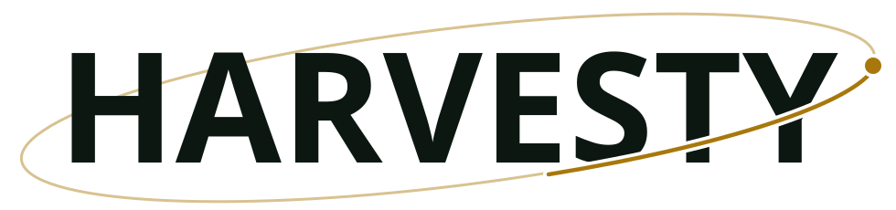

<p align="center">
  <picture>
    <source media="(prefers-color-scheme: dark)" srcset="harvesty/assets/harvesty-logo-escuro.svg">
    
  </picture>
</p>

# Field Shift · Harvesty

**NASA Space Apps Challenge 2026 · desafio "Field Shift: Adapting Farms with NASA Data"**

> *English summary:* A decision-support tool for family farmers in western Santa Catarina, Brazil. The farmer draws the farm on a map, describes what they grow, and gets the climate risks of that exact place (frost, dry years, soil loss), "what if" options with trade-offs, and answers by text or voice. Every number comes from NASA POWER and SRTM, carries an evidence level, and links back to the data and script that produced it. We tested 38 ideas with a pre-registered protocol; the README below (in Portuguese) explains what passed, what failed and what we do not claim.

**App:** https://claude.ai/artifact/BGkMxtrbkzzJPTdhyXsfMD (ou abra `harvesty/dist/index.html` localmente)

---

## O que é

Usamos dados da NASA para transformar a incerteza do clima em probabilidades, para que o agricultor familiar escolha a rotação com menos risco de perder a safra.

O agricultor:
1. **delimita a fazenda** no mapa (uma vez);
2. **conta o que tem**: atividade, culturas, quando planta, solo, prioridades;
3. **vê os riscos daquele lugar**, calculados com 45 anos de clima diário: geada no 2º milho, geada no milho de verão, aviso de ano seco, solo raso nos morros, chuva que arrasta solo;
4. **pergunta "e se…?"** e compara caminhos (ganha, arrisca, chance);
5. **pergunta por texto ou voz** e ouve a resposta. A resposta usa só os números calculados.

Cada número mostra o **nível de evidência**, **o que não sabemos** e o **rastro** até o dado e o script.

## Dados da NASA usados

| Dado | Para quê |
|---|---|
| **NASA POWER** diário, 1981–2025 (temperatura mínima, máxima e média, chuva, umidade, vento, radiação), 20 pontos da grade no Oeste de SC | geada, data-limite do 2º milho, balanço de água do milho, chuva erosiva |
| **SRTM** 1″ (NASA/USGS), 8 folhas, reamostrado a ~90 m | relevo, declive, "confirme o solo" dos morros |
| Sentinel-2 e MODIS (nas validações) | solo descoberto, vigor da lavoura |

Fontes externas (IBGE PAM, ZARC/MAPA, Epagri, Conab, Embrapa) entram **só para conferir resultados**, nunca como entrada. O contorno dos municípios (IBGE) serve só para desenhar o mapa. Três parâmetros vêm de literatura (R = 0,88 da Embrapa; raiz de 0,6 m e limiar de geada de 2 °C do ZARC).

## Como sabemos (e o que não afirmamos)

Testamos **38 ideias** em 10 frentes paralelas, com o mesmo protocolo: critério de sucesso escrito antes do teste, linha de base, conferência externa e uma régua de 9 critérios. Depois, 7 frentes adversariais tentaram derrubar as ideias do topo.

- **A ideia original** ("chance de colher todo ano" pelo balanço de água) **não passou em Santa Catarina**: acompanha a produção do IBGE tão mal quanto a chuva bruta (ρ 0,28 contra 0,28). Ela virou um **motor por módulos** que responde a decisões específicas.
- **O que passou (nível N2, com ressalva):** a data-limite do 2º milho pela geada; tirar agosto da janela do milho de verão; o aviso de ano seco pelo percentil da própria célula; metade da silagem em sorgo no talhão declarado raso.
- **O que caiu:** o alerta de ano extremo com limiar fixo (os acertos "fora da amostra" eram os mesmos anos vistos em regiões vizinhas), época de plantio, El Niño como previsão, área e vigor da cebola por satélite, regra de venda da cebola, entre outros.
- **Nenhum módulo é N3 (validado).** Não afirmamos que o motor prevê a safra, que o satélite mede o solo, que sem aviso o ano é seguro, nem ganho em dinheiro. A lista completa está em `solucao/spec-v2.md`, seção 9.

Ranking e fichas: `loop-validacao/RANKING.md` e `loop-validacao/fichas/`. Relatórios adversariais: `solucao/validacao/V1` a `V7`.

## Estrutura

```
harvesty/          o app estático (artifact) e os scripts que geram os dados
harvesty-web/      o app full-stack em Next.js (API, banco SQLite das fazendas, pergunta ao Claude)
solucao/           spec v2, motor em Python (com testes), interface WhatsApp + auditoria, validações V1–V7
loop-validacao/    protocolo, 38 fichas, ranking, galeria e scripts das 10 frentes de teste
prototipo/         primeiro protótipo (Semiárido, Quixadá)
spec-solucao.md    spec v1 (Semiárido), mantida como histórico
```

## Como rodar

Requisitos: Python 3 com numpy; `curl`.

```bash
# app: monta a página a partir dos dados já gerados
bash harvesty/scripts/build.sh
python3 -m http.server 8767 --directory harvesty/dist
```
Abra `http://localhost:8767`. Para baixar de novo o NASA POWER e o SRTM e recalcular tudo: `bash harvesty/scripts/build.sh --baixar`.

```bash
# motor: gera e valida as saídas de São Miguel do Oeste, Ituporanga e Quixadá
python3 solucao/motor/gerar.py
python3 -m unittest discover solucao/motor/tests
```

```bash
# app full-stack (Next.js, Node 22.13 ou mais novo)
cd harvesty-web && npm install && npm run dev
```
Abra `http://localhost:3000`. Detalhes em `harvesty-web/README.md`.

No app estático, a pergunta por voz e a leitura em áudio só funcionam dentro do claude.ai (artifact); no app Next, usam o navegador e uma chave da API do Claude opcional. Guia de uso do app estático: `harvesty/README.md`.

Dados brutos grandes (cópias do POWER das validações, imagens de satélite, PDFs e planilhas externas) **não estão no repositório**. Os scripts de cada validação mostram de onde baixar.

## Uso de IA

A ideia, o problema e as decisões de escopo são do time. Usamos o Claude (Anthropic) para escrever código, rodar e documentar as validações, revisar afirmações e gerar textos. No app, o Claude só explica números que o motor já calculou (e, no artifact, transcreve a pergunta e lê a resposta em voz alta); ele não calcula nenhuma chance.

## Licença

Código sob licença MIT (`LICENSE`). Os dados da NASA seguem a política de dados abertos da NASA; os dados externos citados seguem as licenças das fontes.
