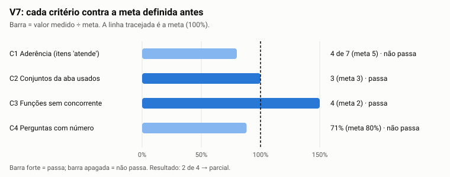
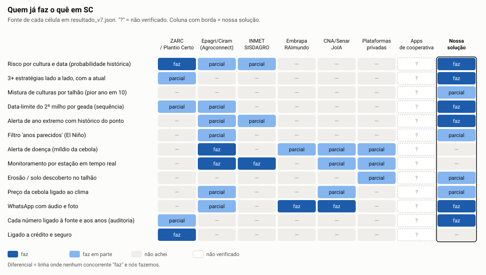
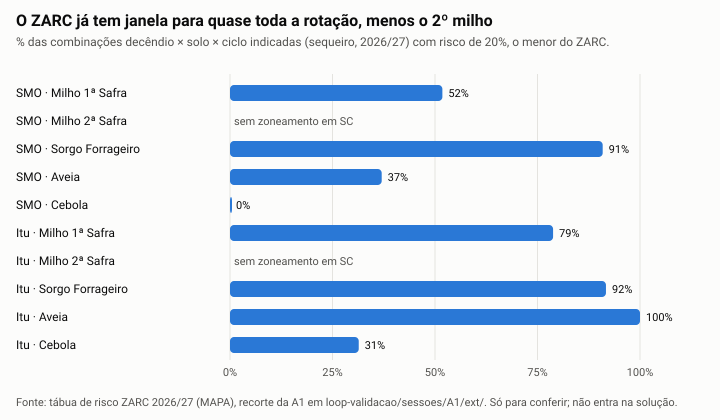

# V7 · Aderência ao desafio e concorrentes

Feito em 14/11/2026. Frente V7 da validação da solução modular.
Script: `v7_analise.py` (roda com `python3 -I v7_analise.py`). Saída: `resultado_v7.json`.
Gráficos: `fig_v7_criterios.svg`, `fig_v7_concorrentes.svg`, `fig_v7_zarc_cobertura.svg`.
Páginas baixadas (com curl, porque o WebFetch falhou com SSL): `externo/`.

---

## 1. Critério definido antes
Está em `00_criterios_antes.md`, escrito antes de montar as matrizes.
- **C1 · Aderência:** dos 7 itens centrais de "Objectives", pelo menos 5 "atende" e nenhum "não".
- **C2 · Dado NASA visível:** pelo menos 3 conjuntos da aba Resources com dado real em módulos que passaram.
- **C3 · Diferencial:** pelo menos 2 funções que nenhum concorrente verificado faz. O canal não conta se alguém já o oferece.
- **C4 · Pitch:** pelo menos 80% das perguntas prováveis do jurado com resposta que tem número de ficha ou script.
- 4 de 4 = sustenta; 2 ou 3 = parcial; 0 ou 1 = não sustenta.

## 2. Método
1. Baixei a página do desafio (Details e Resources) e o guia de julgamento e de submissão do Space Apps. O script confere 7 trechos-chave no texto baixado (todos achados).
2. Codifiquei à mão a aderência (7 itens) com a prova de cada um: ficha do loop ou seção da spec.
3. Listei os conjuntos de dados usados nos módulos que passaram (B3-3, B1-1, A4-3, A3-1, B4-1, B4-3, A2-4).
4. Fiz a varredura de concorrentes que atendem SC: ZARC/Plantio Certo, Epagri/Ciram (Agroconnect, Cebola Net, Analisador de Estiagens), INMET SISDAGRO, Embrapa RAImundo, CNA/Senar JoIA, plataformas privadas e apps de cooperativa. Para cada função marquei "faz", "parcial", "não achei" ou "não verificado", com a fonte.
5. Conferi no CSV do ZARC 2026/27 (recorte da A1) quais culturas da rotação ele já cobre em SMO e Ituporanga.
6. Listei 17 perguntas prováveis do jurado e a melhor resposta que temos hoje.

## 3. Resultado

| Critério | Medido | Meta | Passa? |
|---|---|---|---|
| C1 Aderência | 4 de 7 "atende", 3 "parcial", 0 "não" | 5 "atende" | **Não** |
| C2 Dado da aba | 3 conjuntos (POWER, SRTM, Sentinel-2); só da NASA: 2 | 3 | Sim, no limite |
| C3 Diferencial | 4 funções sem concorrente que "faz" (2 validadas, 2 de desenho) | 2 | Sim |
| C4 Perguntas | 12 de 17 com número (71%) | 80% | **Não** |

[CÁLCULO, `v7_analise.py`]

### 3.1 O que o desafio pede (texto oficial, lido em 14/11/2026)
- "You may compare at least three rotation strategies, including the existing rotation." Para cada uma: por que foi sugerida, evidência, benefícios, lacunas e riscos que pedem revisão local. [DADO, `externo/desafio_texto.txt`]
- A ferramenta "does not replace farmer judgment or local agricultural expertise".
- Considerações opcionais: risco de geada, épocas de solo descoberto, explicar a incerteza, entrada de prioridades e restrições do agricultor, nutrientes, pragas, mercado.
- A página chama IA de **"SI"** (Super Intelligence). Usar o mesmo termo no pitch.
- A seção Objectives cita também GRACE/GRACE-FO, que não usamos.

### 3.2 Aderência item a item (C1)

| # | Item | Estado | Prova |
|---|---|---|---|
| R1 | NASA + solo + cultura + prioridades | parcial | POWER, solo raso/fundo e Kc/Ky entram (B3-3, A4-3). **Não há pergunta de prioridade** no fluxo |
| R2 | 3+ estratégias, incluindo a atual | parcial | SMO tem 3 com número: atual (milho silagem → aveia), 2º milho até a data-limite de geada (B1-1), mistura milho+sorgo no solo raso (A4-3). **Ituporanga não tem 3 rotações testadas** |
| R3 | Por que foi sugerida | atende | Motivo gerado pelo módulo (spec, seção 3) |
| R4 | Evidência | atende | "Em 36 anos, 4 anos com ISNA < 0,75..." (B3-3) e o frontend de auditoria (spec Q9) |
| R5 | Benefícios | parcial | Produção sim (pior ano em 10: +0 a +14%, A4-3). Solo (N, matéria orgânica, praga) não é calculado |
| R6 | Lacunas | atende | "Quando o sistema diz não sei" (spec 7) e limites por ficha |
| R7 | Riscos para revisão local | atende | Frontend do técnico; aviso fora da janela do ZARC |

Itens secundários: geada **atende** (B1-1); incerteza **atende** ("x em 10", faixa 0 a 14%, n = 9 El Niños); solo descoberto **parcial** (A3-1 passou com ajuste; B2-1 a B2-4 descartadas); mercado **parcial** (B4, preço externo); prioridades como entrada **não**; nutrientes e pragas **não**.

### 3.3 Uso visível de dado NASA (C2)
- Usados com dado real em módulos que passaram: **NASA POWER** (todos), **Sentinel-2** e **SRTM** (A3-1). [DADO, fichas]
- Só NASA de fato: POWER e SRTM. O Sentinel-2 é da ESA (parceira, está na aba).
- **Não usados:** IMERG e SMAP (pedem login Earthdata; `IMERG_PRECTOT` do POWER volta vazio), GLDAS, ECOSTRESS, Landsat, ERA5. MODIS só em módulos descartados (A5-3, B5-1). GAEZ só como valor de tabela. [DADO, PROTOCOLO.md e fichas]
- O guia de julgamento pede NASA "como componente central, não adição superficial" (Relevance). POWER é central; os outros dois aparecem só no módulo de erosão.
- Para ser elegível a prêmio global basta usar 1 dado NASA. Isso está cumprido. [DADO, guia de submissão]

### 3.4 Concorrentes que atendem SC (C3)

O que achei, por concorrente:
- **ZARC / Plantio Certo (MAPA/Embrapa).** Já tem janela de risco para 53 culturas em SMO e 58 em Ituporanga, incluindo milho 1ª safra, sorgo forrageiro, aveia, milheto, trigo e cebola. [CÁLCULO, CSV A1] É exigido no crédito e no seguro. **Não tem "Milho 2ª Safra" em SC.** Dá uma cultura por vez, sem sequência nem mistura. O painel ganhou nova interface em fev/2026 ([Cultivar](https://revistacultivar.com.br/noticias/painel-do-zarc-ganha-nova-interface-e-agiliza-consulta-ao-risco-climatico)).
- **Epagri/Ciram.** O Agroconnect mostra por estação: balanço hídrico, ET0, **ISNA**, déficit, excesso, **possíveis geadas**, graus-dia, % da chuva normal e alerta fitossanitário, inclusive **míldio da cebola**. Tem boletins por e-mail e podcasts gerados por IA. [DADO, `externo/agroconnect.html`] O **Analisador de Estiagens** usa **ERA5-Land a 1 km, 1989–2023** por município. [DADO, `externo/ciram_estiagens.txt`] Tem Cebola Net (preço diário, alerta de míldio) e previsão de geada. Há um grupo de WhatsApp no site.
- **INMET SISDAGRO.** Balanço hídrico de cultivo por estação, com perda de produtividade estimada e previsão de 5 dias ([INMET](https://portal.inmet.gov.br/servicos/sisdagro); [CNA](https://cnabrasil.org.br/noticias/plataforma-amplia-acesso-a-dados-agrometeorologicos-para-produtores-planejarem-o-manejo-em-mt)).
- **Embrapa RAImundo.** Assistente no WhatsApp para a agricultura familiar, com MAPA, MDA e a AZap.AI. Beta em 2025, mais de 2.900 interações, meta de 100 mil produtores. Não cita ZARC, probabilidade nem rotação ([Agrolink](https://www.agrolink.com.br/noticias/ia-com-sotaque-do-campo-conecta-pequenos-produtores_504336.html)).
- **CNA/Senar JoIA.** Lançado em 25/08/2026. WhatsApp com texto, áudio e foto. Clima dos próximos dias, cotações, custos, crédito. Piloto de 45 dias com mais de 10 mil produtores. Não cita risco em probabilidade, ZARC nem rotação ([CNA](https://cnabrasil.org.br/noticias/joia-sistema-cna-senar-leva-inovacao-para-ajudar-produtor-a-tomar-decisoes)).
- **Plataformas privadas** (Aegro, FieldView, EOSDA, Agrosmart): NDVI e gestão da safra; Agworld e EOSDA registram a rotação, sem avaliar cenários. [DADO, `pesquisa-solucoes-atuais.md`, 1.3]
- **Apps de cooperativa:** não verificado. Só achei que a Cooperalfa usa o Cooperate Mobile para a assistência técnica ([Cultivar](https://www.revistacultivar.com.br/noticias/solucoes-de-mobilidade-potencializam-o-relacionamento-com-produtores)). Não achei app da Aurora nem da Copérdia.
- **Semiárido:** a Funceme prepara um app de solo, clima e manejo, previsto até 2027 ([Diário do Nordeste](https://diariodonordeste.verdesmares.com.br/ceara/novo-aplicativo-cruzara-solo-e-clima-para-indicar-melhor-epoca-de-plantar-no-ce-1.3707523)).

**Funções em que nenhum concorrente "faz" e nós fazemos** [CÁLCULO, `resultado_v7.json`]:
1. Data-limite do 2º milho por geada, para escolher entre 2º milho e pastagem de inverno. **Validado** (B1-1). O ZARC não zoneia milho 2ª safra em SC.
2. Alerta de ano extremo com o histórico do ponto ("nesses anos quebrou x%"). **Validado fora da amostra** (B3-3). Agroconnect e SISDAGRO mostram o estado atual, não o histórico de quebra.
3. 3 ou mais estratégias lado a lado, com a atual. **Só desenho.**
4. Cada número ligado à fonte e aos anos. **Só desenho.**

Em parte, sem concorrente: mistura de culturas por talhão (A4-3, ajustar).

**O canal não é diferencial.** RAImundo e JoIA já fazem WhatsApp com áudio e foto, de graça, com o peso da Embrapa e da CNA.

### 3.5 O diferencial real
Não é o WhatsApp. Não é o balanço hídrico: o nosso motor reproduz o ZARC em 94% (A1-1), e o Agroconnect já mostra o ISNA por estação.

O diferencial é **juntar camadas que hoje estão soltas** num cartão por talhão:
- a sequência inteira (verão e inverno), não uma cultura por vez;
- o pior ano em 10 da mistura no talhão raso;
- a data-limite de geada da 2ª cultura;
- o alerta de ano extremo com o que aconteceu nos anos parecidos;
- e cada número rastreável pelo técnico.

Fora de SC, o motor roda onde não há estação, porque o POWER é global. Em SC isso pesa pouco, porque a Epagri/Ciram tem rede densa de estações. No Semiárido pesa mais.

Frase sugerida: **"O ZARC diz se uma cultura dá certo. O Agroconnect diz como está hoje. Nós comparamos a sequência inteira do seu talhão, com o pior ano em 10 e de onde vem cada número."**

### 3.6 Perguntas do jurado (C4)

| # | Pergunta | Resposta com o que temos | Número? |
|---|---|---|---|
| 1 | O ZARC já faz isso. Por que vocês? | Motor reproduz o ZARC em 94% (A1-1). O ZARC não tem milho 2ª safra em SC nem mistura. Compomos a sequência | Sim |
| 2 | O modelo funciona em SC? | Não para o ano comum: ρ = 0,28, igual à chuva bruta (B1-0). Por isso só usamos extremos | Sim |
| 3 | O alerta funciona fora da amostra? | Milho: 4 anos em 36, 2 com quebra > 15%. Cebola: 3 de 4 (B3-3). Amostra pequena | Sim |
| 4 | 50 km para talhão pequeno? | Alerta na safra a 50 km falhou (B5-2). Células vizinhas com r de 0,76 a 0,97 (A2-4). Usamos para a série longa | Sim |
| 5 | É rotação ou previsão de seca? | SMO: 3 estratégias com número (B1-1, A4-3). Ituporanga ainda não | Sim |
| 6 | Tamanho do problema? | Estiagem 2021/22: −43% do milho de SC (A1-1). Cebola: −55% em 2015, −27,5% em 2023 (B3-2) | Sim |
| 7 | Qual a incerteza? | Faixa de 0 a 14% (A4-3); n = 9 El Niños (A2-4) | Sim |
| 8 | Por que não alerta de míldio? | O Agroconnect já faz (B5-3). Mandamos para ele | Sim |
| 9 | RAImundo e JoIA já estão no WhatsApp | JoIA: piloto com 10 mil produtores. O canal é deles; o motor é nosso e pode servir a eles | Sim |
| 10 | Usaram dado de fora? | Só para conferir. **Exceção a corrigir:** ONI da NOAA em A2-4 | Sim |
| 11 | Funciona em outra região? | Quixadá: 16 de 18 decêndios iguais ao ZARC (spec 6) | Sim |
| 12 | O que muda no El Niño de 2026/27? | 9 El Niños: 1 out–jan seco e 6 chuvosos (A2-4) | Sim |
| 13 | **Cadê IMERG e SMAP?** | Não usados (login Earthdata) | **Não** |
| 14 | **Testaram com agricultor?** | Não. Só alcance: 50,5% dos estabelecimentos de SC com internet em 2017 (B5-2) | **Não** |
| 15 | **O LLM inventa número?** | Por desenho não (spec Q9), mas sem teste | **Não** |
| 16 | **Quanto ganha em dinheiro?** | Só na cebola: prejuízo de 6 para 2 anos (B4-3). No leite, não medido | **Não** |
| 17 | **Usaram SI para ter a ideia?** | O regulamento proíbe. Precisamos declarar onde a IA entrou | **Não** |

## 4. Conferência externa

- **O ZARC confirma a sobreposição.** No ZARC 2026/27 de sequeiro, o sorgo forrageiro tem risco de 20% (o menor) em 91% das combinações indicadas em SMO e 92% em Ituporanga. O milho 1ª safra tem 52% em SMO e 79% em Ituporanga. Não há milho 2ª safra em nenhum dos dois. [CÁLCULO, `v7_analise.py` sobre o CSV da A1] Para "qual cultura tem menos risco de água", o ZARC já responde. O espaço livre é a sequência e o 2º milho.
- **A Epagri/Ciram já usa ERA5**, que está na aba Resources, a 1 km. [DADO, `externo/ciram_estiagens.txt`] Isso mostra que o dado é aceito pelo órgão local. Também mostra que "dado de satélite por município" não é novidade em SC.
- **Regras do Space Apps 2026** [DADO, `externo/judging_guide.txt` e `externo/submission_guide.txt`]:
  - 5 critérios de 1 a 5: Impact, Creativity, Validity, Relevance, Presentation.
  - Demo: até **7 slides** (com título) ou vídeo de até **30 segundos**.
  - Tudo em **inglês**; vídeo em português só com legenda em inglês.
  - Prazo: **domingo, 15/11, 23h59** no horário do evento local.
  - SI: permitida como ferramenta, **não para ter a ideia**. Imagem e vídeo gerados por SI precisam de marca d'água; áudio, código e dados gerados por SI precisam ser declarados. Nada de logo da NASA em conteúdo gerado.
  - A Agência Espacial Brasileira é parceira em 2026. Isso é uma porta (dado de parceiro "highly encouraged"), mas a regra 1 do time limita à aba Resources. Decisão do time.

## 5. Veredito
**Parcial (2 de 4).**
- Passa: dado da aba visível (no limite) e diferencial (2 funções validadas sem concorrente).
- Não passa: aderência (4 de 7 "atende") e preparo do pitch (71% das perguntas com número).
- O motor modular cumpre o espírito do desafio em **São Miguel do Oeste**. Em **Ituporanga** ainda não há 3 estratégias de rotação com número. O canal WhatsApp **não** é diferencial.

## 6. Implicações para a solução
1. **Abrir o pitch pela família de leite de SMO.** É onde há 3 estratégias com número: atual, 2º milho até a data-limite de geada, mistura com sorgo no solo raso. Ituporanga entra como 2º cartão (alerta de ano extremo e erosão). Quixadá, numa linha.
2. **Fechar R2 em Ituporanga** com 3 estratégias: cebola no convencional (atual), cebola em plantio direto sobre palha de milho ou aveia (A3-1, erosão) e a regra de venda pela chuva da primavera (B4). Marcar a 3ª como mercado, não rotação.
3. **Fechar R1 com uma pergunta de prioridade** no WhatsApp ("o que pesa mais: silagem garantida, renda ou solo?"). Ela muda a ordem dos cartões, não o cálculo.
4. **Fechar R5 com benefícios de solo em texto, com fonte e marcados "a validar"** (leguminosa fixa N, palha reduz erosão). Não inventar número.
5. **Posicionar contra o ZARC e o Agroconnect como complemento.** Mandar o míldio para o Agroconnect e o crédito para o ZARC. Mostrar na auditoria a janela do ZARC ao lado da nossa.
6. **Não vender o WhatsApp como novidade.** Dizer: "o motor pode responder dentro de bots que já existem".
7. **Reforçar o dado NASA:** conseguir login Earthdata e mostrar IMERG ou SMAP como camada no frontend, mesmo sem entrar no cálculo. Trocar o ONI da NOAA pela TSM do ERA5 (A2-4).
8. **Cumprir as regras de SI:** declarar o uso de IA no código, na pesquisa e no áudio (TTS). Pôr marca d'água em imagem gerada. Deixar claro que a ideia veio do time (Miro, 5 Porquês).
9. **Demo em 7 slides, em inglês**, até 15/11 às 23h59. Sugestão: título; problema em SC; a pergunta da família ("colhi a silagem em 25/jan: 2º milho ou aveia?"); o cartão com 3 estratégias; os dados NASA e a auditoria; a validação honesta (B3-3 fora da amostra, ZARC 94%, ρ = 0,28 no ano comum); o que falta.

## 7. Limites
- Matriz de concorrentes montada por busca e leitura de páginas. Não testei os apps por dentro. "Não achei" não quer dizer que a função não exista.
- Apps de cooperativa ficaram como "não verificado".
- A nota de cada célula é minha. Outra pessoa poderia marcar "parcial" onde marquei "não achei", e vice-versa.
- Não li os relatórios das frentes V1 a V6, que estão em andamento. Se V1 (ataques ao B3-3) ou V2 (geada) derrubarem os módulos, o C3 cai para 0 funções validadas.
- As perguntas do jurado são previsão minha, não pesquisa com jurados.
- O guia de julgamento lido é o de 2026, mas a rubrica detalhada por nota só traz a descrição da nota 5.

## 8. Fontes
- Desafio: https://www.spaceappschallenge.org/2026/challenges/adapting-farms-with-nasa-data/ (cópia em `externo/desafio.html` e `externo/desafio_texto.txt`).
- Guia de julgamento: https://www.spaceappschallenge.org/resources/judging-awards-guide (cópia em `externo/judging_guide.txt`).
- Guia de submissão: https://www.spaceappschallenge.org/resources/project-submission-guide/ (cópia em `externo/submission_guide.txt`).
- Epagri/Ciram: https://ciram.epagri.sc.gov.br/agroconnect/, https://ciram.epagri.sc.gov.br/index.php/analisador-estiagens/, https://ciram.epagri.sc.gov.br/cebolanet/ (cópias em `externo/`).
- ZARC 2026/27: recorte da A1 em `loop-validacao/sessoes/A1/ext/zarc_2627_smo_itu.csv` e `zarc_perene_smo_itu.csv`.
- JoIA: https://cnabrasil.org.br/noticias/joia-sistema-cna-senar-leva-inovacao-para-ajudar-produtor-a-tomar-decisoes
- RAImundo: https://www.agrolink.com.br/noticias/ia-com-sotaque-do-campo-conecta-pequenos-produtores_504336.html
- SISDAGRO: https://portal.inmet.gov.br/servicos/sisdagro
- Painel do ZARC 2026: https://revistacultivar.com.br/noticias/painel-do-zarc-ganha-nova-interface-e-agiliza-consulta-ao-risco-climatico
- Funceme: https://diariodonordeste.verdesmares.com.br/ceara/novo-aplicativo-cruzara-solo-e-clima-para-indicar-melhor-epoca-de-plantar-no-ce-1.3707523
- Cooperalfa: https://www.revistacultivar.com.br/noticias/solucoes-de-mobilidade-potencializam-o-relacionamento-com-produtores
- Fichas do loop: `loop-validacao/fichas/` (A1-1, A2-4, A3-1, A4-1, A4-3, B1-0, B1-1, B3-1, B3-2, B3-3, B4-1, B4-3, B5-2, B5-3).
- Pesquisa anterior de soluções: `pesquisa-solucoes-atuais.md`.
